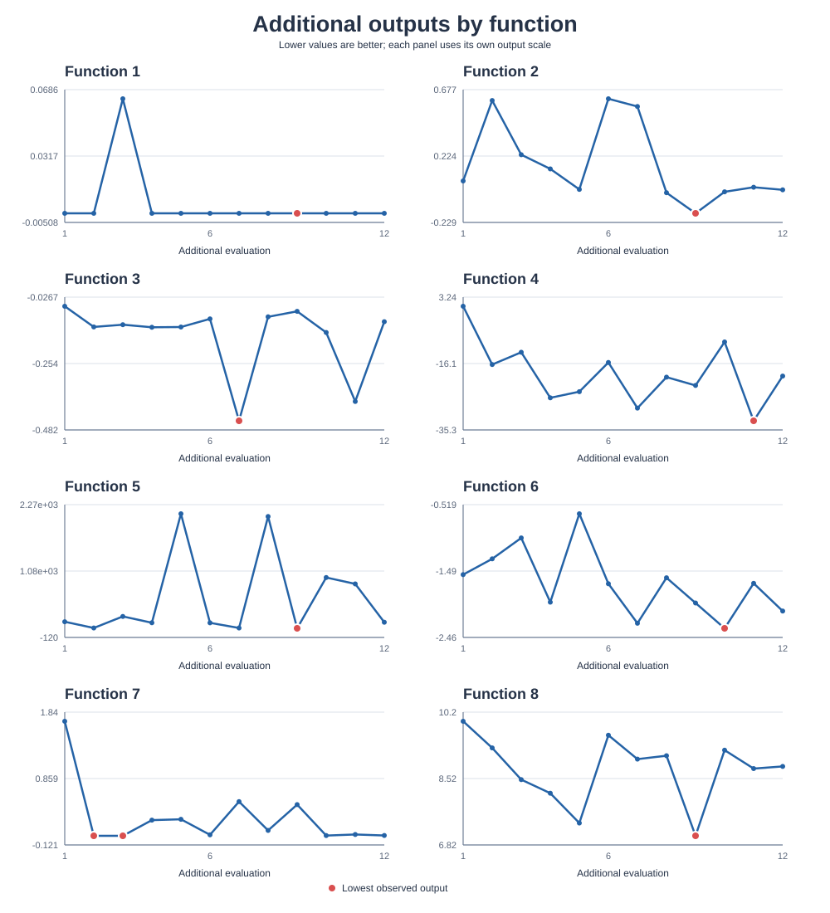

# Black-Box Optimization Capstone

**Imperial College Professional Certificate in Machine Learning and Artificial Intelligence**

This project explores how to choose promising inputs for eight unknown functions when evaluations are limited. Each function accepts between two and eight inputs in the unit interval and returns one scalar output. The objective in this implementation is to **minimize** that output.

## A non-technical explanation

Think of each function as a sealed machine: you provide settings and receive a score, but you cannot see how the machine works. Because each evaluation is valuable, choosing the next settings carefully matters. This project uses a Gaussian process to estimate both likely output values and uncertainty, then uses those estimates to propose the next input.

## Data

The starter observations are stored as NumPy arrays under `initial_data/function_N/`. Each runner also includes 12 additional input/output pairs in its `ADDITIONAL_INPUTS` and `ADDITIONAL_OUTPUTS` class attributes.

| Function | Input dimensions | Starter observations | Additional observations |
|---|---:|---:|---:|
| 1 | 2 | 10 | 12 |
| 2 | 2 | 10 | 12 |
| 3 | 3 | 15 | 12 |
| 4 | 4 | 30 | 12 |
| 5 | 4 | 20 | 12 |
| 6 | 5 | 20 | 12 |
| 7 | 6 | 30 | 12 |
| 8 | 8 | 40 | 12 |

All input dimensions are bounded from 0 to 1. The underlying functions and their analytical forms are not included; the code uses the supplied observations to propose candidates.

## Method

The shared `BayesianOptimizer` fits a Gaussian-process surrogate using a constant-scaled RBF kernel. It then searches for a candidate within the input bounds using SciPy's L-BFGS-B optimizer with multiple random starting points.

The default acquisition strategy is **Expected Improvement (EI)** for minimization: it favors candidates expected to improve on the lowest observed output. **Lower Confidence Bound (LCB)** is also available and balances predicted output against uncertainty. The runner classes configure the kernel length scale and optimizer restart counts for their respective functions.

The runner proposes an input; it does not evaluate the hidden function. After an external evaluation, add the returned input/output pair to the corresponding runner's observation data before requesting another candidate.

## Current observed results

The table reports the lowest output in each current observation set. These are observed values, not estimates of the unknown global minima. Because output scales differ by function, compare values only within the same function.

| Function | Lowest starter output | Lowest additional output | Lowest output overall |
|---|---:|---:|---:|
| 1 | -0.003606 | -1.37e-61 | -0.003606 |
| 2 | -0.065624 | -0.166653 | -0.166653 |
| 3 | -0.398926 | -0.450368 | -0.450368 |
| 4 | -32.625660 | -32.683385 | -32.683385 |
| 5 | 0.112940 | 44.565423 | 0.112940 |
| 6 | -2.571170 | -2.323404 | -2.571170 |
| 7 | 0.002701 | 0.014529 | 0.002701 |
| 8 | 5.592193 | 7.051065 | 5.592193 |

The chart below shows each additional output in evaluation order. Each function has an independent vertical scale; red markers identify the lowest additional output.



## Run a benchmark

Install the project's Python dependencies (`numpy`, `scipy`, `scikit-learn`, and `matplotlib`) in your environment, then run a benchmark from the repository root:

```powershell
python -m pip install numpy scipy scikit-learn matplotlib
python -m runner.function_1
```

Replace `function_1` with `function_2` through `function_8` to run a different function. Each module exposes a `FunctionNRunner` class and prints its proposed input and the lowest observed output.

## Run a function in PyCharm

1. Open the project root (the folder containing `README.md`, `initial_data`, `runner`, and `utility`) in PyCharm.
2. Select the project's Python interpreter. If needed, create a virtual environment and install the dependencies listed above in PyCharm's terminal.
3. In the Project pane, open `runner` and choose the function file, for example `function_1.py`.
4. Right-click the file and select **Run 'function_1'**. Alternatively, open **Run > Edit Configurations**, add a **Python** configuration, set the script to `runner\function_1.py`, and set the working directory to the project root.
5. To run a different benchmark, select `function_2.py` through `function_8.py` or change the script path in the run configuration. The proposed input and lowest observed output appear in the Run tool window.

## Plot additional outputs

Create a PDF comparing the 12 additional outputs for all eight functions:

```powershell
python -m runner.plot_outputs
```

By default, the PDF is written to `additional_outputs.pdf` in the repository root. Choose another PDF path with:

```powershell
python -m runner.plot_outputs --output plots\additional_outputs.pdf
```

The plotting helper `plot_additional_outputs` in `utility/plotting_utils.py` accepts a mapping of function IDs to output arrays and returns a Matplotlib figure and its axes.

## Repository layout

```text
README.md                         Project overview and usage
initial_data/function_1..8/       Starter input and output arrays
runner/
  benchmark_runner.py             Shared runner data loading and execution
  function_1.py .. function_8.py  Per-function classes and observations
  plot_outputs.py                 Save output comparison as a PDF
utility/
  acquisition_functions.py        EI, UCB, and LCB calculations
  bayesian_optimizer.py           Shared Gaussian-process optimizer
  plotting_utils.py               Plotting helpers
presentation/                     Project presentation
```

## References

- Rasmussen, C. E. and Williams, C. K. I. (2006). *Gaussian Processes for Machine Learning*. MIT Press.
- Jones, D. R., Schonlau, M. and Welch, W. J. (1998). Efficient global optimization of expensive black-box functions. *Journal of Global Optimization*, 13, 455-492.
